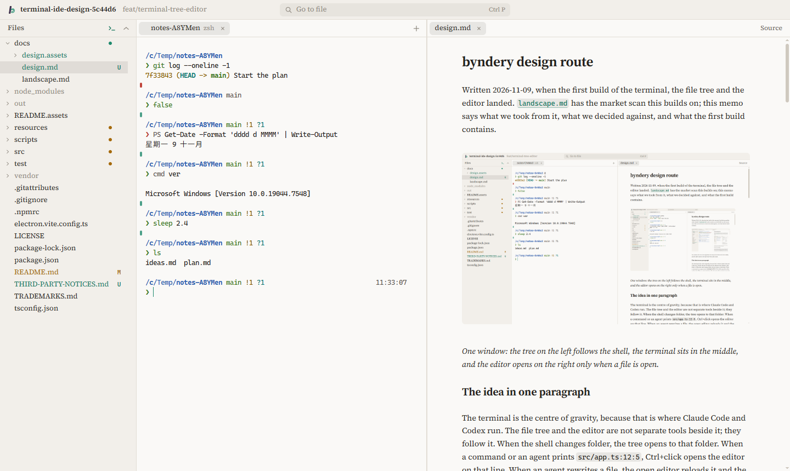

# byndery


byndery is a workspace to use alongside terminal coding agents such as Claude Code and Codex. It puts a real terminal, a file tree and an editor for the files an agent writes (Markdown first) in one window, and links them: a path in terminal output opens in the editor, the tree follows the shell's folder, a file an agent rewrites reloads in the editor with the change highlighted, and a selection in the editor goes to the agent as context.

The name comes from a bindery, the workshop where loose sheets are sewn into one book.



## Recent changes

- **2026-11-09.** First working build: terminal, file tree and editor in one window. On Windows the terminal is zsh with Powerlevel10k, suggestions and syntax highlighting on a bundled MSYS2, and the same prompt also runs PowerShell cmdlets, cmd built-ins and paths written as `C:\` or `/c/`. The design and the reasons for it are in [`docs/design.md`](docs/design.md).

## Running it

byndery runs from source for now; there is no installer yet. You need Node.js 22 or later and, on Windows, Git for Windows (its `tar` unpacks the bundled shell).

```bash
npm install
```

```bash
node scripts/vendor-shell.mjs
```

```bash
npm run dev
```

The second command builds the shell environment in `vendor/`: MSYS2 with zsh and git, Powerlevel10k, gitstatusd and the usual zsh plugins, about 390 MB. In mainland China add `--mirror tuna` to download from the Tsinghua mirror. Without it, byndery falls back to Git Bash, then PowerShell.

`npm run dev` opens the folder you start it in. Pass another folder as an argument, or use Ctrl+O.

## Keys

| Keys | Does |
|---|---|
| Ctrl+P | Go to a file; `>` for commands, `:` for a line, or paste an absolute path |
| Ctrl+Shift+P | Commands |
| Ctrl+click on a path in the terminal | Open it in the editor at that line |
| Ctrl+L in the editor | Send the file and selected lines to the terminal as `@path#L3-9` |
| Ctrl+E in the editor | Switch Markdown between rendered and source |
| Ctrl+Up, Ctrl+Down in the terminal | Previous or next prompt |
| Ctrl+` | Move between the terminal and the editor |
| Ctrl+Shift+` | New terminal |
| Ctrl+B | Show or hide the file tree |
| Ctrl+S, Ctrl+W | Save, close tab |
| Ctrl+, | Settings |

Ctrl+C copies when terminal text is selected and interrupts otherwise; Ctrl+V pastes.

On Windows the prompt also takes PowerShell and cmd commands: `Get-Process | Where-Object CPU -gt 100` runs in PowerShell, `copy`, `del` and `mklink` run in cmd, and `C:\Users\me` works as a path. Start a line with `pwsh:`, `cmd:` or `zsh:` to choose the system yourself. Settings (Ctrl+,) switches each system on or off; the rules are in [`docs/design.md`](docs/design.md).

## Tests

```bash
npm test
```

```bash
npm run build && npm run e2e
```

`npm run e2e` starts the real app on a scratch repository and drives it: shell integration, links, the tree, the editor, the command router and both path forms.

## Licence

The code is released under the [MIT License](LICENSE). The byndery and Holarky names and logos are not covered by it; see [`TRADEMARKS.md`](TRADEMARKS.md). The bundled shell environment and libraries keep their own licences; see [`THIRD-PARTY-NOTICES.md`](THIRD-PARTY-NOTICES.md).
