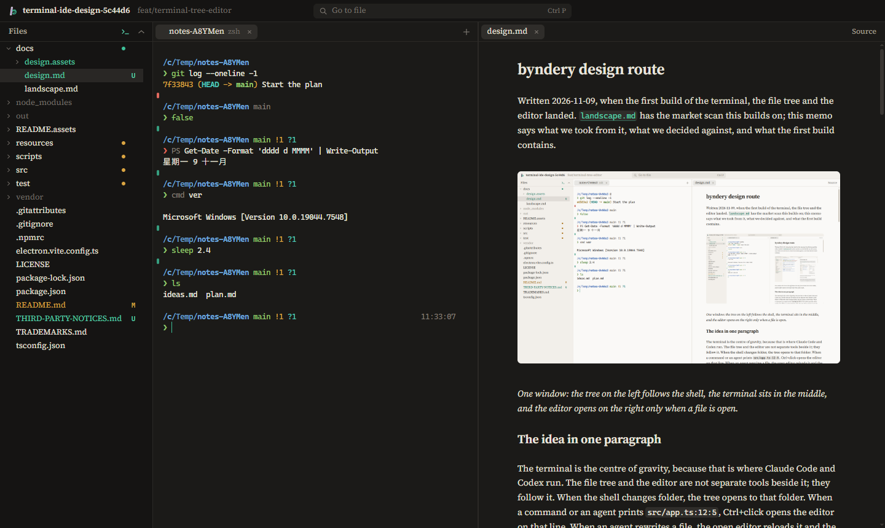
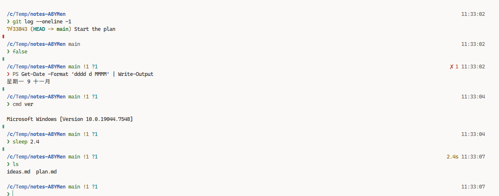
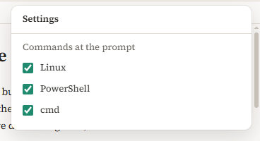

# byndery design route

Written 2026-11-09, when the first build of the terminal, the file tree and the editor landed. [`landscape.md`](landscape.md) has the market scan this builds on; this memo says what we took from it, what we decided against, and what the first build contains.

*One window: the tree on the left follows the shell, the terminal sits in the middle, and the editor opens on the right only when a file is open.*

## The idea in one paragraph

The terminal is the centre of gravity, because that is where Claude Code and Codex run. The file tree and the editor are not separate tools beside it; they follow it. When the shell changes folder, the tree opens to that folder. When a command or an agent prints `src/app.ts:12:5`, Ctrl+click opens the editor on that line. When an agent rewrites a file, the open editor reloads it and the changed lines glow for two seconds. In the other direction, Ctrl+L sends the editor's selection to the terminal as `@src/app.ts#L12-20`, the form Claude Code reads, and dragging a file from the tree types its path at the prompt.

## What we took, and from whom

The research pass looked at Warp, Wave, Zed, Ghostty, cmux, Conductor, Nimbalyst, Paseo, Paradev, Cursor 3, VS Code, Kitty, WezTerm, yazi, broot and Obsidian. These are the ideas that made it into the first build.

| Idea | Taken from | Where it lives in byndery |
|---|---|---|
| Shell integration through OSC 133 and OSC 7 | VS Code, Ghostty, WezTerm | `resources/shell/` scripts; marks beside each prompt |
| Ctrl+Up and Ctrl+Down between prompts | VS Code | terminal |
| `path:line:col` links, including tsc's `(12,5)` and Python tracebacks | VS Code, Zed, Warp | `src/shared/links.ts` |
| Single click opens a preview tab, double click keeps it | VS Code, Warp | editor tabs |
| Markdown renders in place and shows its syntax only under the cursor | Obsidian | `src/renderer/src/markdown-live.ts` |
| Ctrl+E switches a Markdown file between rendered and source | Warp | editor |
| Drag a file onto the terminal to type its path | Warp, Wave | tree and terminal |
| Git state in the tree, rolled up to folders | VS Code, broot | `src/renderer/src/tree.ts` |
| One input for files, commands (`>`) and lines (`:`) | VS Code | Ctrl+P |
| The editor follows what the agent touches | Zed | reload with highlight on disk change |

## What users complained about, and the rule we took from it

| Complaint | Product | Rule in byndery |
|---|---|---|
| Forced sign-in, telemetry, AI pushed into the terminal | Warp | No account, no telemetry, no built-in AI. The agents are whatever you run in the terminal. |
| The prompt and line editor replaced by the app's own | Warp | Raw pty bytes in both directions. Integration only adds escape sequences. |
| The file tree hidden or reset by layout changes | Cursor 3, Codex app | The tree is always there unless you hide it, and the layout persists. |
| Markdown shown raw; relative images resolved against the wrong folder | Claude Code desktop, Codex app | Rendered by default; images resolve against the file's own folder. |
| Electron terminals that feel slow | Hyper, Wave | WebGL renderer, batched and flow-controlled pty output, a virtualised tree, no UI framework. |
| Output repeated after a resize on Windows | VS Code, Zed | ConPTY build number passed to xterm.js; resizes debounced; node-pty's newer bundled ConPTY. |
| Git Bash not found | Claude Code, Cursor | byndery brings its own shell environment, and finds Git Bash the way VS Code does as a fallback. |
| Background events stealing focus | VS Code with agents | Nothing but your own action moves focus. |
| Notes locked into one app's folder format | Obsidian | Any folder opens as it is; app state lives in Electron's user-data folder. |

## Native feel and speed

The window uses the system's own caption buttons (`titleBarOverlay`), so snap layouts and the maximise behaviour are Windows' own. Context menus are native menus. The interface follows the system's light or dark setting, and the caption buttons are recoloured to match.

The renderer is plain TypeScript with no UI framework. The terminal draws with WebGL. Pty output crosses IPC in batches every five milliseconds, and the pty pauses while the renderer has more than 512 KB unparsed, which is the watermark scheme from the xterm.js flow-control guide. Only the visible rows of the tree exist in the DOM. Editor languages load on first use. The prompt runs without forking except for git, because each fork costs tens of milliseconds under MSYS2.

## Type and colour

*Dark mode follows the system setting, and the system's caption buttons are recoloured to match.*

Source Serif 4 for the interface and for Markdown prose, bundled so every platform gets the same face. Its optical-size axis switches to the caption design at 12 to 13 px, which keeps small labels sturdy. Cascadia Mono for code and the terminal. Warm neutrals with one accent, the mint of the icon's bowl; amber marks modified files and red marks failures and conflicts.

## The shell on Windows

byndery's default shell is zsh with Powerlevel10k, running on an MSYS2 that ships inside the app. You do not install MSYS2, zsh or the prompt; they are part of byndery. If the bundle is missing, byndery uses a system MSYS2 with zsh, then Git Bash with a Powerlevel10k-style bash prompt, then PowerShell.

*Lean layout: folder, branch with counts, then ❯ on its own line. Failures, slow commands and the time sit on the right.*

The bundled MSYS2 starts in its UCRT64 environment, inherits the Windows PATH so `node`, `claude` and `codex` work, mounts `/tmp` on your Windows temp folder, and uses your Windows profile folder as `~`, so `~/.ssh`, `~/.gitconfig` and `~/.zshrc` are the ones every other tool uses. Your own `.zshrc` runs first; byndery adds its hooks afterwards and applies its prompt only if you have not chosen one.

The plugins most people add by hand come with it: zsh-autosuggestions (grey suggestions from history), zsh-syntax-highlighting, zsh-completions, zsh-history-substring-search on the arrow keys, and Oh My Zsh's git aliases. Each is skipped when your own config already loads it. Under MSYS2 every new process costs tens of milliseconds, so suggestions run synchronously and from history only; with all plugins loaded a typed character reaches the screen in 1.3 ms on the build machine, against 25 ms with the plugins' default settings.

`scripts/vendor-shell.mjs` builds the bundle: it downloads a pinned MSYS2 archive and checks its SHA-256, unpacks it, installs zsh and git with pacman, adds Powerlevel10k, gitstatusd and the plugins, and writes the list of packages with their licences, so nothing is downloaded when byndery runs.

### One prompt for Linux, PowerShell and cmd

You type at one zsh prompt, and each line goes to the system that understands it. Windows programs run from zsh as they are. The rules come from how tools that mix languages already resolve this: Nushell runs its own commands first and reaches a program on PATH with `^name`, xonsh decides per line whether it is Python or a command, WSL runs a Windows program when you type its `.exe`, and PowerShell 6 dropped its Unix-named aliases on Linux because they hid the real commands.

*Settings, Ctrl+,: each system can take part or not. The last one checked cannot be cleared.*

A line goes to the first rule that matches:

1. A prefix: `zsh: …`, `pwsh: …` or `cmd: …`. Prefixes work even for a system switched off in Settings.
2. Syntax only PowerShell parses: an approved Verb-Noun first word (`Get-Process`, checked against PowerShell's verb list so a typo such as `docker-compos` stays in zsh), `$env:`, `$name =` or `[Type]::`.
3. zsh's own lookup: alias, function, builtin, program on PATH. The exceptions are `dir` and `cd /d`, which go to cmd while cmd is on.
4. cmd built-ins: `copy`, `del`, `ren`, `md`, `rd`, `move`, `mklink`, `ver`, `vol`, `assoc`. `cls` clears the screen.
5. Otherwise zsh reports the command as not found. With Linux switched off, plain lines go to PowerShell, or to cmd.

A whole line goes to one system, so `Get-Process | Where-Object CPU -gt 100` keeps its PowerShell meaning, and later stages of a pipeline are programs found on that system's PATH. After a PowerShell or cmd line, its folder, exit code and environment changes come back to zsh: `cd /d D:\x` moves the zsh prompt, `$env:X = 1` is visible to the next command, and the prompt shows `✘` with the right code. The line on screen and in history is what you typed, with a grey `PS` or `cmd` in front when another system ran it.

Where a name exists in more than one system, the research behind these rules settled the winner:

| Name | Runs in | Because |
|---|---|---|
| `ls`, `cat`, `rm`, `cp`, `mv`, `mkdir`, `sort`, `find`, `where` | zsh | Pipelines need the Unix tools; Git for Windows orders PATH the same way |
| `dir` | cmd | Linux users type `ls`; Windows users expect `dir /s /b` |
| `echo`, `set`, `type`, `cd` | zsh | zsh owns the working folder; cmd's forms of these are rare at a prompt |
| `cd /d C:\x` | cmd, folder handed back | Windows users type it; zsh would reject `/d` |
| `md`, `rd`, `del`, `copy`, `move`, `ren`, `mklink` | cmd | zsh has no such names |
| `curl`, `wget` | the real programs | PowerShell 5.1's aliases for them are removed in routed lines |
| `ipconfig`, `winget`, `whoami.exe` | Windows | Programs on PATH, run directly |

Unquoted Windows paths in zsh lines are read as paths: `cd C:\Users\me` works, as does `/c/Users/me`. Both forms also work in terminal links and in Ctrl+P.

Every line in PowerShell or cmd starts a fresh process for now, so PowerShell's own variables (`$x = 1`) do not carry to the next line, and each line pays PowerShell's start-up time of about half a second. One PowerShell process per terminal tab fixes both and is the next step for this part.

### Known limit

Powerlevel10k's git segment does not appear inside worktrees whose `.git` file records a Windows path (`gitdir: C:/…`), which is what Git for Windows writes by default. gitstatusd, built for MSYS2, cannot follow that path. Running `git config --global worktree.useRelativePaths true` before creating worktrees avoids it.

## Licences of the bundled parts

MSYS2's packages, zsh, Powerlevel10k and gitstatusd run as separate programs that byndery starts, so their licences do not extend to byndery's own MIT code. Shipping them requires keeping their notices and making the source of the GPL parts available; [`THIRD-PARTY-NOTICES.md`](../THIRD-PARTY-NOTICES.md) does both.

## Next

The order below follows what the research ranked most valuable and what the first build did not reach.

1. One PowerShell process per terminal tab, so PowerShell variables persist between lines and routed lines start instantly.
2. Review agent edits as hunks you keep or revert, collected in one review view.
3. Register as Claude Code's IDE (the `~/.claude/ide/` lock file), so the agent sees the editor's selection and can open diffs.
4. A memory of every command with its output, exit code and folder, searchable later; the model is Atuin, which keeps shell history in SQLite. Then sync across devices with end-to-end encryption on the Holarky account, and sharing a command with its output as a link.
5. Attention marks: a badge on a terminal tab when its command finishes or an agent waits for input.
6. Split terminals, and a terminal search bar.
7. The installer, with the bundle and the notices in it.
