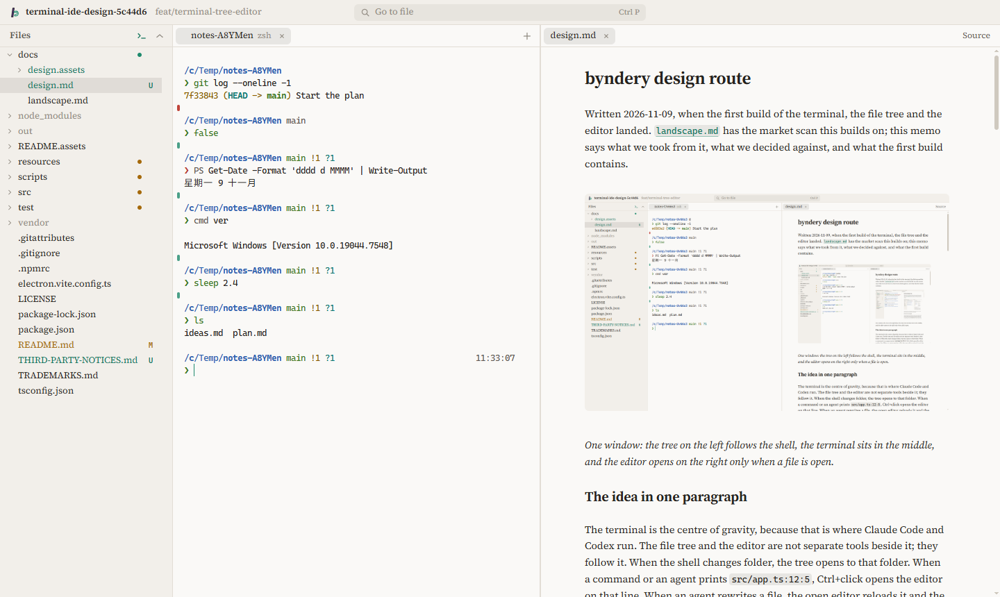
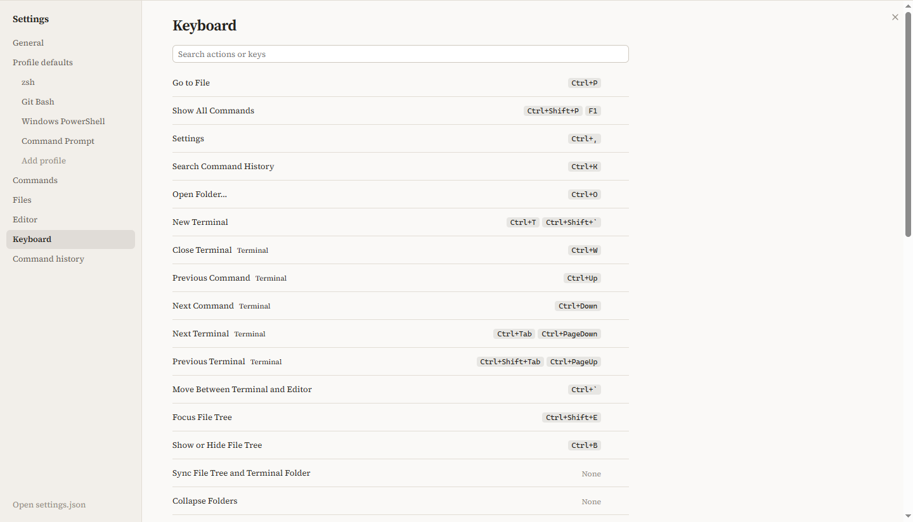
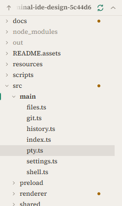
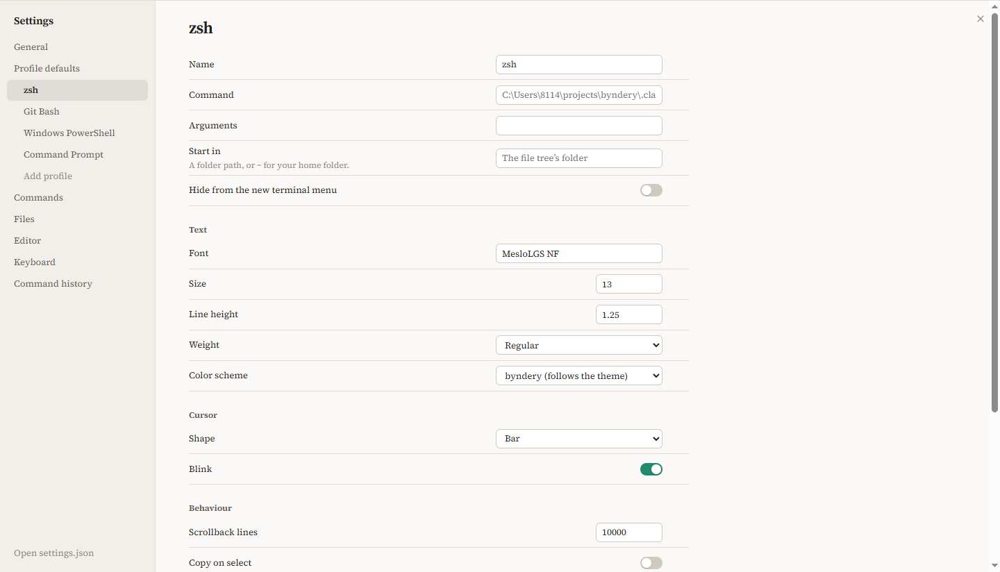
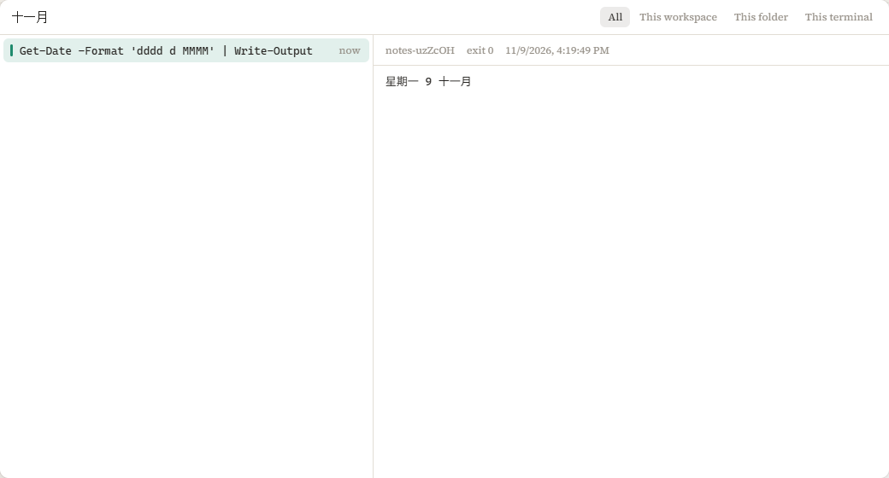

# byndery design route

2026-11-13: byndery moved from Electron to Tauri: the backend is Rust (`src-tauri`) and the page is drawn by the system's web view; the renderer is unchanged behind the same `Bridge` interface. Release installers cover Windows x64 and ARM64, macOS Intel and Apple Silicon, and Linux x64 and ARM64. Windows x64 also bundles MSYS2; other targets use the shells provided by their operating system. Byndery can host PowerShell and Command Prompt with the signed-in user's permissions, and on Windows 11 22H2 and later it can be the default terminal for console programs started outside it (see [`RELEASE.md`](RELEASE.md)).

Written 2026-11-09, when the first build of the terminal, the file tree and the editor landed, and updated the same day for keys, folder sync, the prompt and settings. [`landscape.md`](landscape.md) has the market scan this builds on; this memo says what we took from it, what we decided against, and what the first build contains.

*One window: the tree on the left, synced here with the terminal, the terminal in the middle, and the editor on the right only when a file is open.*

## The idea in one paragraph

The terminal is the centre of gravity, because that is where Claude Code and Codex run. The file tree and the editor are not separate tools beside it; they follow it. The editor is for whatever the agent touches, code, configuration or notes, with no file type treated as the main one. With sync on, the tree and the shell share one folder: a `cd` moves the tree, and a folder clicked in the tree becomes the shell's. When a command or an agent prints `src/app.ts:12:5`, Ctrl+click opens the editor on that line. When an agent rewrites a file, the open editor reloads it and the changed lines glow for two seconds. In the other direction, Ctrl+L sends the editor's selection to the terminal as `@src/app.ts#L12-20`, the form Claude Code reads, and dragging a file from the tree types its path at the prompt.

## What we took, and from whom

The research pass looked at Warp, Wave, Zed, Ghostty, cmux, Conductor, Nimbalyst, Paseo, Paradev, Cursor 3, VS Code, Kitty, WezTerm, yazi, broot and Obsidian. These are the ideas that made it into the first build.

| Idea | Taken from | Where it lives in byndery |
|---|---|---|
| Shell integration through OSC 133 and OSC 7 | VS Code, Ghostty, WezTerm | `resources/shell/` scripts; marks beside each prompt |
| Ctrl+Up and Ctrl+Down select a command and its output | VS Code, iTerm2 | terminal |
| `path:line:col` links, including tsc's `(12,5)` and Python tracebacks | VS Code, Zed, Warp | `src/shared/links.ts` |
| Single click opens a preview tab, double click keeps it | VS Code, Warp | editor tabs |
| Markdown can render in place, showing its syntax only under the cursor; Ctrl+E switches to source | Obsidian, Warp | `src/renderer/src/markdown-live.ts` |
| Drag a file onto the terminal to type its path | Warp, Wave | tree and terminal |
| Git state in the tree, rolled up to folders | VS Code, broot | `src/renderer/src/tree.ts` |
| One input for files, commands (`>`) and lines (`:`) | VS Code | Ctrl+P |
| The editor follows what the agent touches | Zed | reload with highlight on disk change |
| The tree and the terminal share a folder both ways | Dolphin's terminal panel | `src/renderer/src/main.ts`, `pathbar.ts` |
| Profiles that inherit from defaults, a reset per value, a JSON file under the window | Windows Terminal, Konsole | `src/shared/settings.ts`, `src/renderer/src/settings.ts` |
| Key bindings as data, editable and checked for clashes | VS Code, Windows Terminal | `src/renderer/src/keymap.ts` |

## What users complained about, and the rule we took from it

| Complaint | Product | Rule in byndery |
|---|---|---|
| Forced sign-in, telemetry, AI pushed into the terminal | Warp | No account, no telemetry, no built-in AI. The agents are whatever you run in the terminal. |
| The prompt and line editor replaced by the app's own | Warp | Raw pty bytes in both directions. Integration only adds escape sequences. |
| The file tree hidden or reset by layout changes | Cursor 3, Codex app | The tree is always there unless you hide it, and the layout persists. |
| Markdown shown raw; relative images resolved against the wrong folder | Claude Code desktop, Codex app | Rendered when you want it; images resolve against the file's own folder. |
| Electron terminals that feel slow and heavy | Hyper, Wave | Tauri with the system's web view, a Rust backend, WebGL renderer, batched and flow-controlled pty output, a virtualised tree, no UI framework. |
| Output repeated after a resize on Windows | VS Code, Zed | ConPTY build number passed to xterm.js; resizes debounced. |
| Git Bash not found | Claude Code, Cursor | byndery brings its own shell environment, and finds Git Bash the way VS Code does as a fallback. |
| Background events stealing focus | VS Code with agents | Nothing but your own action moves focus. |
| Notes locked into one app's folder format | Obsidian | Any folder opens as it is; app state lives in byndery's own data folder. |

## Native feel and speed

On macOS the window keeps the system's traffic lights over byndery's title bar. On Windows and Linux byndery draws its own caption buttons at the right of the title bar, which moves the window and maximises on double-click. Context menus are native menus. The interface follows the system's light or dark setting.

The renderer is plain TypeScript with no UI framework. The terminal draws with WebGL. Pty output crosses IPC in batches every five milliseconds, and the pty pauses while the renderer has more than 512 KB unparsed, which is the watermark scheme from the xterm.js flow-control guide. Only the visible rows of the tree exist in the DOM. Editor languages load on first use. The prompt runs without forking except for git, because each fork costs tens of milliseconds under MSYS2.

## Type and colour

*Dark mode follows the system setting, and the caption buttons follow it.*

Source Serif 4 for the interface and for prose, bundled so every platform gets the same face. Its optical-size axis switches to the caption design at 12 to 13 px, which keeps small labels sturdy. Cascadia Mono for code in the editor, and MesloLGS NF in the terminal, because the prompt is drawn for it. Warm neutrals with one accent, the mint of the icon's bowl; amber marks modified files and red marks failures and conflicts.

## Keys

Every shortcut is an entry in one table (`src/renderer/src/keymap.ts`): an action, its default keys and the pane where they work. A key goes to the focused pane's action first and to the window's otherwise, so Ctrl+T opens a terminal from the terminal or the tree and an untitled file from the editor, and Ctrl+W closes whichever of the two has focus. The Keyboard page in Settings edits the same table and warns when two actions share keys.

*Settings, Keyboard: click a binding and press the new keys; Backspace removes it.*

| Keys | Why these |
|---|---|
| Ctrl+T, Ctrl+W | What browsers and Windows Terminal use for tabs. In the terminal they shadow readline's transpose and delete-word; Alt+Backspace still deletes a word. |
| Ctrl+K | Opens the command memory. Ctrl+R stays with the shell's own reverse search, which people already know. |
| Ctrl+Up, Ctrl+Down | VS Code's keys for moving between commands. The selected command is outlined with its output even when it is already on screen. |
| F1 and Ctrl+Shift+P | VS Code's pair for the command list. A global hotkey in another program takes a key before any window sees it; Phevere uses Ctrl+Shift+P for its now-playing lookup, so F1 is always there. |

Ctrl+C copies when terminal text is selected and leaves the selection in place, as VS Code does. Tools that read selected text, Phevere among them, send their own Ctrl+C half a second after a mouse selection; clearing on copy, as Windows Terminal does, made every selection vanish.

## The tree goes anywhere and can follow the shell

*The path bar above the tree, with sync on: the folder the terminal is in is open and selected.*

The tree's root is a path bar. A part of the path goes to that folder, a click on the empty part takes a typed path in either form (`C:\x` or `/c/x`, `~` or relative), Alt+Up goes to the parent and Alt+Left and Alt+Right go back and forward, the way a file manager works. At a drive's root, Up offers the other drives. Double-click goes into a folder.

The sync button ties the tree and the active terminal together. It copies Dolphin's terminal panel, which has done this for years: a folder clicked in the tree is sent to the shell, and the shell's `cd` moves the tree, revealing the folder or re-rooting the tree when the shell leaves it. Like Dolphin, byndery sends the `cd` only when the shell is at an idle prompt, clears what is typed first, and starts the line with a space so zsh and bash keep it out of history; a running program is never sent keystrokes. Sync starts off.

## The shell on Windows

On Windows x64, byndery's default shell is zsh with Powerlevel10k in its full rainbow style, running on the MSYS2 bundle. Windows ARM64 uses native PowerShell and Command Prompt profiles, plus Git Bash when installed. macOS and Linux use the system shell; zsh gets the bundled Powerlevel10k prompt when it is available. On Windows x64, if the bundle is missing, byndery uses a system MSYS2 with zsh, then Git Bash, then PowerShell.

*Rainbow layout: OS icon, folder and git status in coloured segments, failures, slow commands and the time on the right, and a frame around the two lines.*

The prompt is Powerlevel10k's own rainbow template, as its configuration wizard writes it for two lines, a full frame, sharp heads and many icons, with the OS icon on. byndery changes three things on top: the template's eight theme colours become fixed 256-colour ones, because a light theme darkens those colours for text and black on a darkened yellow is unreadable; the git segment stays empty until gitstatus answers, instead of showing "loading"; and the icons use the Nerd Fonts v3 code points of MesloLGS NF, the font Powerlevel10k recommends, which `npm install` fetches with pinned hashes. The lean layout stays available as a profile setting, and a `~/.p10k.zsh` of your own replaces both.

The Windows x64 MSYS2 bundle starts in its UCRT64 environment, inherits the Windows PATH so `node`, `claude` and `codex` work, mounts `/tmp` on your Windows temp folder, and uses your Windows profile folder as `~`, so `~/.ssh`, `~/.gitconfig` and `~/.zshrc` are the ones every other tool uses. Your own `.zshrc` runs first; byndery adds its hooks afterwards and applies its prompt only if you have not chosen one.

The plugins most people add by hand come with it: zsh-autosuggestions (grey suggestions from history), zsh-syntax-highlighting, zsh-completions, zsh-history-substring-search on the arrow keys, and Oh My Zsh's git aliases. Each is skipped when your own config already loads it. Under MSYS2 every new process costs tens of milliseconds, so suggestions run synchronously and from history only; with all plugins loaded a typed character reaches the screen in 1.3 ms on the build machine, against 25 ms with the plugins' default settings.

`scripts/vendor-shell.mjs` builds the bundle: it downloads a pinned MSYS2 archive and checks its SHA-256, unpacks it, installs zsh and git with pacman, adds Powerlevel10k, gitstatusd and the plugins, and writes the list of packages with their licences, so nothing is downloaded when byndery runs.

### One prompt for Linux, PowerShell and cmd

You type at one zsh prompt, and each line goes to the system that understands it. Windows programs run from zsh as they are. The rules work the way a shell already resolves a name. PowerShell tries alias, function, cmdlet, then program, and lets a module-qualified name or `&` reach a shadowed one; zsh tries alias, keyword, function, builtin, then PATH, with `command` and `builtin` to force a choice; Nushell sends `^name` to the program on PATH. All of them have the same four parts, and byndery uses the same four: a fixed lookup order, a prefix that forces one choice for a line, a way to pin a name, and a command that explains the decision, as `type -a` and `Get-Command -All` do.

*Settings, Commands: the systems in the order they are asked, each with a switch and a prefix; names pinned to one system; and a box that asks the router where a line would run.*

A line goes to the first rule that matches:

1. A prefix: `zsh:`, `pwsh:` or `cmd:` by default, each one editable. A prefix works even for a system that is switched off.
2. A name pinned to a system in Settings. `dir` is pinned to cmd by default, because Windows users expect `dir /s /b` and Linux users type `ls`.
3. Syntax only one system parses. PowerShell gets `$env:`, `$name = …`, `[Type]::` and an approved Verb-Noun first word that zsh does not know (checked against PowerShell's verb list, so a typo such as `docker-compos` stays in zsh); this rule can be switched off. cmd gets `cd /d`.
4. The systems in their order, Linux, PowerShell and cmd by default. The first that knows the first word runs the line: zsh by its own lookup, PowerShell by Verb-Noun, cmd by its built-in commands (`copy`, `del`, `ren`, `md`, `rd`, `move`, `mklink`, `ver`, `vol`, `assoc`).
5. Nothing knows it: the first system that is on reports the error.

The router records which rule decided. The Commands page asks the router itself, so it never guesses differently from the shell, and `byndery-route <line>` prints the same answer in the terminal, for example `PowerShell (PowerShell cmdlet)` or `Linux (program /usr/bin/find)`. Settings writes the rules to a small file that zsh reads on every Enter without starting a process, so a change reaches terminals that are already open.

A whole line goes to one system, so `Get-Process | Where-Object CPU -gt 100` keeps its PowerShell meaning, and later stages of a pipeline are programs found on that system's PATH. After a PowerShell or cmd line, its folder, exit code and environment changes come back to zsh: `cd /d D:\x` moves the zsh prompt, `$env:X = 1` is visible to the next command, and the prompt shows the right exit code. The line on screen and in history is what you typed, with a grey `PS` or `cmd` in front when another system ran it.

With the default order, the names that exist in more than one system go here:

| Name | Runs in | Because |
|---|---|---|
| `ls`, `cat`, `rm`, `cp`, `mv`, `mkdir`, `sort`, `find`, `where` | zsh | Pipelines need the Unix tools; Git for Windows orders PATH the same way |
| `dir` | cmd | Pinned by default |
| `echo`, `set`, `type`, `cd` | zsh | zsh owns the working folder; cmd's forms of these are rare at a prompt |
| `cd /d C:\x` | cmd, folder handed back | Windows users type it; zsh would reject `/d` |
| `md`, `rd`, `del`, `copy`, `move`, `ren`, `mklink` | cmd | zsh has no such names |
| `curl`, `wget` | the real programs | PowerShell 5.1's aliases for them are removed in routed lines |
| `ipconfig`, `winget`, `whoami.exe` | Windows | Programs on PATH, run directly |

Unquoted Windows paths in zsh lines are read as paths: `cd C:\Users\me` works, as does `/c/Users/me`. Both forms also work in terminal links and in Ctrl+P.

Every line in PowerShell or cmd starts a fresh process for now, so PowerShell's own variables (`$x = 1`) do not carry to the next line, and each line pays PowerShell's start-up time of about half a second. One PowerShell process per terminal tab fixes both and is the next step for this part.

### Known limit

Powerlevel10k's git segment does not appear inside worktrees whose `.git` file records a Windows path (`gitdir: C:/…`), which is what Git for Windows writes by default. gitstatusd, built for MSYS2, cannot follow that path. Running `git config --global worktree.useRelativePaths true` before creating worktrees avoids it.

## Settings

Settings work the way Windows Terminal and Konsole work, because people who live in terminals already know those two. `settings.json` holds only what you changed; the defaults live in the code, as in VS Code and Windows Terminal, so a new version can improve a default you never touched. The file may have comments and trailing commas. Open settings.json in Settings opens it in byndery's editor, and a saved edit applies at once; a file that cannot be read is reported at the top of Settings while the last good settings stay in force.

Terminal settings live in profiles. byndery makes one for each shell it finds (the bundled zsh, Git Bash, PowerShell, Windows PowerShell, Command Prompt and each WSL distribution on Windows; the shells in `/etc/shells` elsewhere), and you can add your own or duplicate one. Every profile inherits font, size, line height, weight, colour scheme, cursor, scrollback, copy on select, right-click paste and the zsh prompt style from Profile defaults, and can override any of them. A reset arrow appears beside every value the page overrides, as in Windows Terminal's settings. Changes apply to terminals that are already open. The menu beside + starts any profile.

*A profile page. The command shows the detected program until you change it; every other value comes from Profile defaults until set here.*

The other pages hold the theme and default profile, the Commands rules above, folder sync, the editor's font size, tab size, wrapping and Markdown preview, the key bindings, and the command memory.

## Command memory

byndery remembers every command with its output, folder, exit code, duration and time, and Ctrl+K searches all of it. Shell history keeps only the command; byndery has the output too, because shell integration already marks where each command's output starts and ends on screen.

*Searching 十一月 finds the `Get-Date` command by its output. Ctrl+K again cycles the scope; Enter runs the command again and Tab puts it on the prompt to edit.*

The model is Atuin, which keeps shell history in SQLite and added output capture of its own in 2026. byndery follows its choices where they apply:

- Ctrl+K opens the search and, pressed again, cycles its scope: everything, this workspace, this folder, this terminal. Enter runs the selected command and Tab puts it on the prompt, as in Atuin's shipped config. Atuin itself takes Ctrl+R; byndery leaves that key to the shell.
- Search matches any part of a command or its output, three characters or longer, in any script. It is SQLite's FTS5 index with the trigram tokenizer, built into the SQLite the Rust backend carries.
- A command typed with a leading space is not kept. Credentials in commands and output (provider tokens, private keys, JWTs, `password=` values) are replaced with ‹redacted› before anything is written. The output of commands that exist to print secrets, such as `printenv`, `gh auth token` and `cat .env`, is never kept.
- Each output keeps its first and last half megabyte, and the oldest outputs are dropped once all of them pass 512 MB; the commands stay.
- On first start, earlier commands come in from `$HISTFILE` or `~/.zsh_history` and `~/.bash_history`, without output.
- Settings has a switch to stop remembering and a button to clear everything.

Every row carries a UUID, so a later sync can merge the histories of several machines without collisions. Sync and sharing a command with its output are the next steps for this part.

## Licences of the bundled parts

MesloLGS NF is under the Apache License 2.0. MSYS2's packages, zsh, Powerlevel10k and gitstatusd run as separate programs that byndery starts, so their licences do not extend to byndery's own MIT code. Shipping them requires keeping their notices and making the source of the GPL parts available; [`THIRD-PARTY-NOTICES.md`](../THIRD-PARTY-NOTICES.md) does both.

## Next

The order below follows what the research ranked most valuable and what the first build did not reach.

1. One PowerShell process per terminal tab, so PowerShell variables persist between lines and routed lines start instantly.
2. Review agent edits as hunks you keep or revert, collected in one review view.
3. Register as Claude Code's IDE (the `~/.claude/ide/` lock file), so the agent sees the editor's selection and can open diffs.
4. Sync the command memory across devices with end-to-end encryption on the Holarky account, and share a command with its output as a link, choosing which parts go, as Warp's shared blocks do.
5. Attention marks: a badge on a terminal tab when its command finishes or an agent waits for input.
6. Split terminals, and a terminal search bar.
7. Paths for files dropped onto a terminal from Explorer or Finder. The move to Tauri lost them: while the tree's own drag and drop works, the web view gives a dropped file no path.
